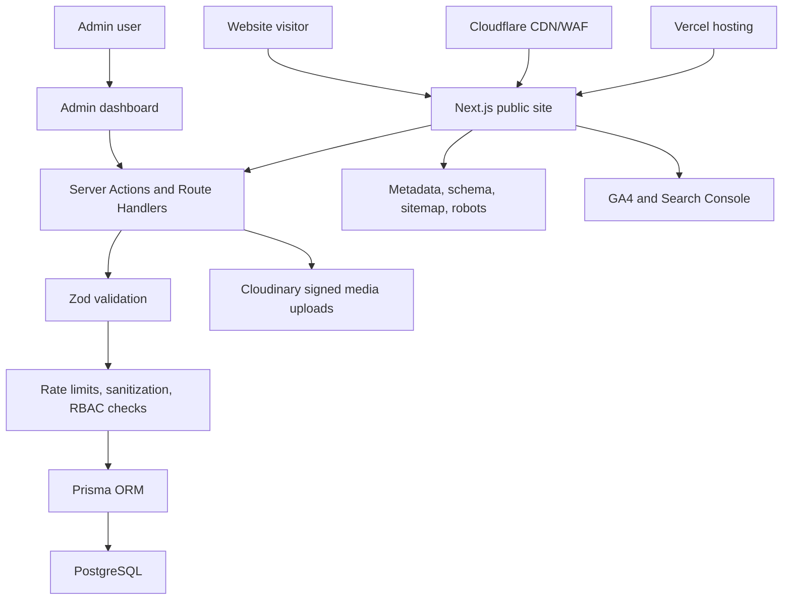

# Phase 1 - Project Analysis and Architecture

## Project Goal

Build a premium, production-ready corporate and lead-generation website for ICONIC FILTRATION AND ENGINEERS LLP, focused on water filtration manufacturing, supply, and engineered solutions.

The site must serve industrial buyers, OEMs, dealers, project consultants, procurement teams, and government or institutional decision makers. It should communicate trust, technical depth, manufacturing capability, and fast enquiry paths.

## Current Workspace

The workspace started as an empty Git repository with no commits. Phase 1 generated the folder structure and planning documents only.

Generated asset:

- `public/brand/iconic-filtration-logo-384.png`

## Brand Direction

The supplied logo combines a water droplet, green leaf, and industrial gear. The website should translate that into a premium industrial identity:

- Deep blue for engineering trust and technical authority
- White and light gray for clean water, clarity, and breathable layouts
- Cyan for water-tech accents, data highlights, and motion states
- Controlled green accents for sustainability and purity cues
- Charcoal for dark technical sections and admin surfaces

Important design note: the brief requests glassmorphism, gradients, dark sections, parallax, and animations. These should be used selectively so the result feels premium and fast, not decorative or heavy.

## Reference Website Signals

Reference reviewed: https://www.aventura.co.in/

Useful information-architecture signals:

- Product-first navigation
- Corporate/about section
- Downloads and support paths
- Distribution/dealer pathway
- Contact and online inquiry actions
- Water treatment, wastewater treatment, and water handling category buckets
- Product detail pages for specific components

Relevant product taxonomy signals observed:

- Water Treatment Components
- Water Handling Equipments
- Wastewater Treatment Equipments
- FRP Vessels
- RO Housing
- Dosing Pumps
- Electro Chlorination System
- Multiport Valves
- Distribution Systems
- RO Membranes
- Domestic RO Membranes
- Filter Cartridges
- Filter Media
- RO Antiscalant
- Cation Exchange Resins
- RO Controller and Instruments

These are structural inputs only. ICONIC should use original content, original visual design, original component layout, and a more modern conversion-focused experience.

## Recommended Improvements to the Brief

1. Treat the public website and admin dashboard as two related products.
   The public site should be highly cached and optimized. The admin dashboard should prioritize secure workflows, auditability, and content operations.

2. Use motion with restraint.
   Framer Motion should handle page and component transitions. GSAP should be reserved for complex scroll scenes or hero interactions where it adds clear value.

3. Add lead qualification.
   Quote and contact forms should capture industry, application, flow rate or capacity, material preference, project stage, location, and timeline. This improves lead quality.

4. Add product data depth.
   Product pages should include specifications, applications, industries, downloadable datasheets, related products, FAQs, and structured data.

5. Add content governance.
   Admin content should support draft/published status, slug history, SEO overrides, image alt text, and audit logs.

6. Plan for production rate limiting.
   On Vercel, production rate limiting should use a managed store such as Redis or a platform edge rate-limit provider rather than in-memory counters.

7. Avoid over-promising Lighthouse 100.
   The architecture will target excellent Core Web Vitals, but third-party analytics, fonts, videos, and admin scripts can affect scores. The build should prioritize measured performance budgets.

8. Keep Cloudinary uploads signed.
   Admin uploads should use signed upload flows and server-side validation for file type, size, and intended usage.

## Proposed Information Architecture

Public site:

- Home
- About
- Products
- Product Categories
- Product Detail
- Industries Served
- Projects
- Case Studies
- Gallery
- Certificates
- Downloads
- Blog
- FAQs
- Contact
- Request Quote
- Privacy Policy
- Terms
- 404

Admin:

- Dashboard
- Products
- Product Categories
- Product Images
- Specifications
- Blogs
- Blog Categories
- Gallery
- Certificates
- Downloads
- Testimonials
- Projects
- Industries
- Quote Requests
- Contact Enquiries
- Newsletter Subscribers
- SEO Metadata
- Site Settings
- Users and Roles
- Audit Logs

## Generated Folder Structure

```text
app/
  (site)/
    about/
    products/
      [slug]/
    industries/
    projects/
    gallery/
    certificates/
    downloads/
    case-studies/
    blog/
      [slug]/
    faqs/
    contact/
    request-quote/
  (legal)/
    privacy-policy/
    terms/
  admin/
  api/
components/
  admin/
  forms/
  layout/
  marketing/
  product/
  seo/
hooks/
lib/
  auth/
  db/
  security/
  seo/
  validators/
prisma/
public/
  brand/
  images/
  videos/
styles/
types/
data/
  seed/
docs/
```

## Application Architecture



## Frontend Architecture

- Next.js App Router with route groups for public, legal, admin, and API areas
- Server Components by default for content-heavy pages
- Client Components only for interactive UI, forms, dashboards, filters, menus, and motion
- Tailwind CSS for styling tokens and layout utilities
- Shadcn UI for accessible primitives and admin controls
- Framer Motion for subtle transitions and reveal effects
- GSAP only for advanced hero or scroll interactions if approved in Phase 2

## Backend Architecture

- Next.js Route Handlers for webhooks, upload signatures, analytics-safe endpoints, and API routes
- Server Actions for validated form submissions and admin mutations
- Prisma for all database reads and writes
- Zod schemas shared between forms, actions, and API handlers
- Auth.js for admin authentication
- Role Based Access Control for admin sections and content actions

## Database Domain Model

The normalized database will be generated in Phase 3. Planned domains:

- Identity: users, roles, sessions, audit logs
- Catalog: products, categories, images, specifications, downloads
- Content: blogs, blog categories, FAQs, projects, case studies, gallery, certificates
- Commercial leads: quote requests, contact enquiries, newsletter subscribers
- SEO: metadata, redirects, slugs, structured data overrides
- Settings: global site settings, contact details, social links, tracking IDs

## Security Architecture

Security controls to design into the implementation:

- Prisma parameterized queries to reduce SQL injection risk
- Zod validation at every external input boundary
- Output escaping through React rendering rules
- Sanitization for rich text or CMS-like fields
- Auth.js secure cookies and session handling
- Password hashing through Auth.js-compatible credentials flow if credentials auth is used
- RBAC checks before admin reads and writes
- CSRF-aware mutation paths
- Per-route rate limits for quote, contact, newsletter, login, and upload endpoints
- Strict security headers in Next.js config or middleware
- Environment variables for all secrets
- Signed Cloudinary uploads
- Audit logs for admin mutations
- Backup strategy documented with the selected PostgreSQL host
- Cloudflare WAF readiness

## SEO Architecture

Each public route should support:

- Semantic HTML
- Metadata API title and description
- Open Graph and Twitter card metadata
- Canonical URLs
- Breadcrumb structured data
- Organization structured data
- Product structured data for product pages
- FAQ structured data where relevant
- Review or testimonial schema where valid
- XML sitemap
- robots.txt
- Image alt text
- Internal linking between categories, products, industries, and quote CTAs

## Performance Architecture

Performance targets:

- Static or incremental rendering for stable marketing pages
- Server-side filtering for heavy catalog pages
- Optimized `next/image` usage
- Responsive image sizing and Cloudinary transformations
- Font loading with `next/font`
- Lazy loaded video and animation assets
- Minimal client-side JavaScript on public pages
- Route-level code splitting
- Admin dashboard isolated from public marketing bundles

## Lead Generation Architecture

Primary conversion paths:

- Sticky request quote action
- Product detail quote CTA
- Category enquiry CTA
- Contact form
- WhatsApp floating action
- Download gated or semi-gated datasheets if approved
- Newsletter subscription

Quote form fields should support technical qualification:

- Name
- Company
- Email
- Phone
- Location
- Industry
- Product category
- Application
- Capacity or flow requirement
- Timeline
- Message
- Attachment upload if needed

## Phase Plan

Phase 2: Design system

Phase 3: Database, Prisma schema, seed file, and ER diagram

Phase 4: Authentication and RBAC

Phase 5: Reusable components

Phase 6: Homepage

Phase 7: Remaining public pages

Phase 8: Admin dashboard

Phase 9: SEO optimization

Phase 10: Performance optimization

Phase 11: Security audit

Phase 12: Deployment guide

## Phase 1 Approval Questions

Before Phase 2, confirm:

1. Should the green from the logo be used as a small sustainability accent in addition to cyan?
2. Should the admin dashboard use credentials login, Google login, or both?
3. Should products initially follow the reference taxonomy, or do you have ICONIC's final product list to use instead?
